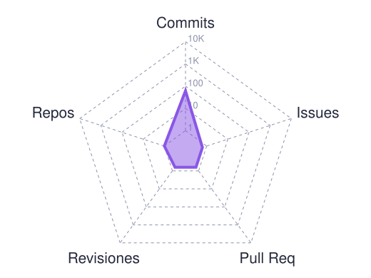
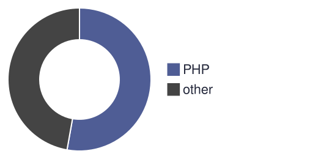

 

 

## Sobre mí

  

 

<table>
<tr>
<td width="50%" valign="top">

**Quién soy**
Estudiante de *Diseño y Desarrollo de Software* en Lima. Me mueve crear cosas: si una idea se puede imaginar, quiero encontrar la forma de construirla.

</td>
<td width="50%" valign="top">

**Qué me interesa**
Software, diseño, web, apps móviles e impresión 3D. No me limito a un solo campo: prefiero entender cómo se conectan y aprender lo que cada proyecto pida.

</td>
</tr>
<tr>
<td width="50%" valign="top">

**Cómo trabajo**
Me importa tanto cómo se ve algo como cómo funciona. Voy de la idea al prototipo y de ahí a algo usable.

</td>
<td width="50%" valign="top">

**Abierto a**
Colaborar, aprender de otros y sumarme a proyectos de cualquier área, no solo de código.

</td>
</tr>
</table>

 

## Stack tecnológico

  

 

## Proyectos

  
  

 

## Estadísticas

 

## Actividad

<table>
<tr>
<td width="50%" align="center" valign="middle">

</td>
<td width="50%" align="center" valign="middle">

</td>
</tr>
</table>

 

## Contacto

¿Tienes un proyecto o quieres colaborar? Escríbeme.

  

  

