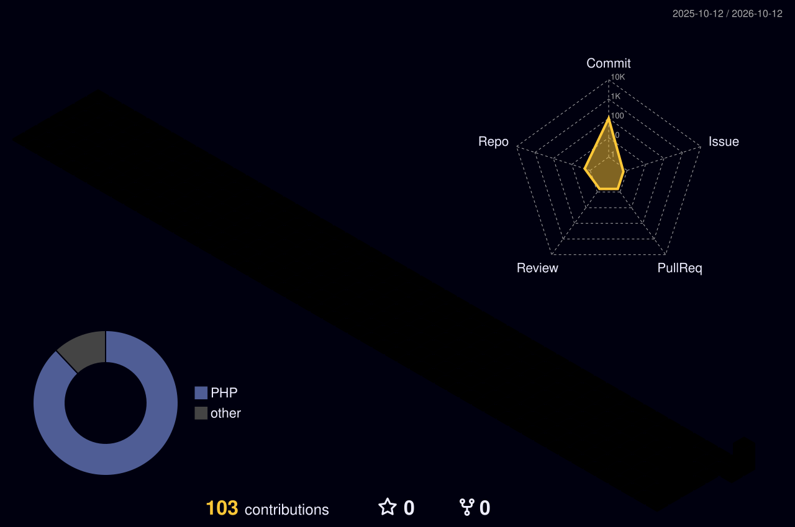

 

 

## Sobre mí

  

 

<table>
<tr>
<td width="50%" valign="top">

**Formación**
Estudiante de *Diseño y Desarrollo de Software*.

</td>
<td width="50%" valign="top">

**Enfoque**
Interfaces web con **React** y servicios con **Node.js**. Me importa tanto cómo se ve como cómo funciona.

</td>
</tr>
</table>

 

## Stack tecnológico

  

 

  

 

## Estadísticas

 

 

## Actividad

  

 

## Contacto

¿Tienes un proyecto o quieres colaborar? Escríbeme.

  

  

